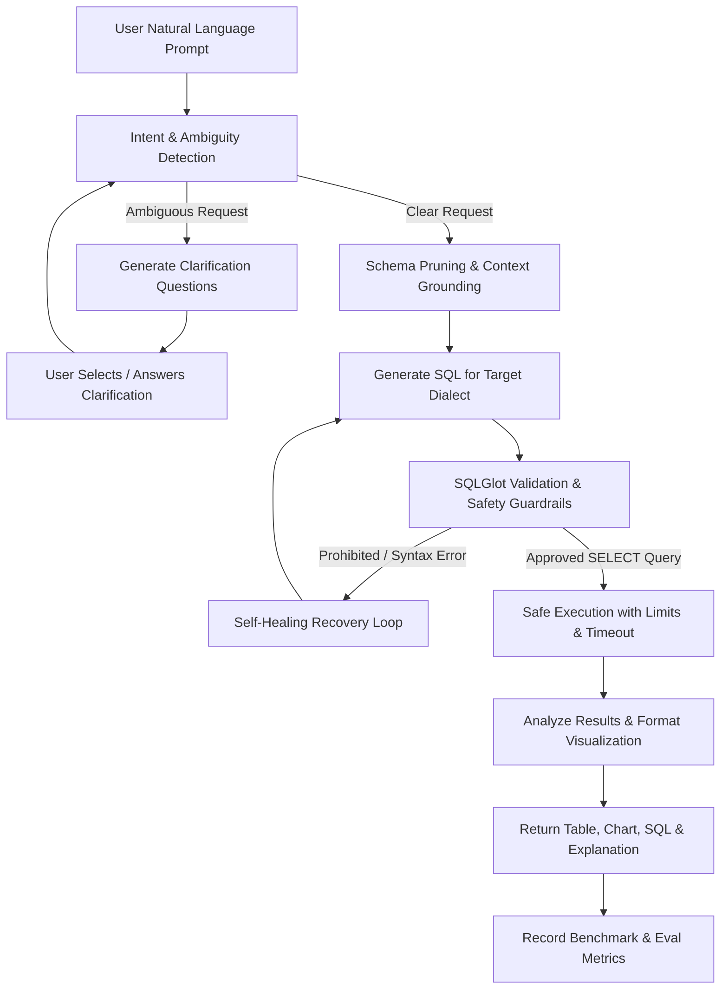

# Text-to-SQL with Clarification Engine 🚀

A production-grade GenAI application enabling users to connect their SQL databases, ask questions in natural English, automatically clarify ambiguities, validate and safely execute queries, and visualize results as interactive tables, charts, and plain-English explanations.

---

## 🌟 Key Capabilities

1. **Multi-Database Connection Manager**
   - Cloud & Local connections: PostgreSQL, MySQL, SQLite (plus demo e-commerce store).
   - Dynamic schema discovery: tables, columns, data types, primary & foreign keys, table statistics.

2. **Clarification Engine (LangGraph Orchestrated)**
   - Distinguishes between unambiguous questions and ambiguous business requests (e.g., *"Show top performing products"* -> asks whether performance means revenue, profit, or units sold).
   - Multi-turn conversation memory with clarifying follow-ups.

3. **SQL Generation & Validation Pipeline**
   - Engine-aware dialect generation (PostgreSQL, MySQL, SQLite).
   - AST validation via **SQLGlot** (enforce strictly `SELECT` read-only statements, block DDL/DML injection, restrict functions, inject row limits and statement timeouts).

4. **Safe Query Execution & Guardrails**
   - Read-only transaction enforcement.
   - Guarded timeouts & execution limits.
   - Comprehensive error recovery and self-healing SQL regeneration.

5. **Rich Results & Visualizations**
   - Interactive, sortable, and searchable data tables.
   - Automatic chart recommendations (Bar, Line, Pie, Area) based on query result shape.
   - Plain-English executive summaries and full generated SQL inspector.

6. **Evaluation Harness & Benchmarking**
   - Automated benchmark suite measuring:
     - Execution Accuracy
     - Result Correctness against golden datasets
     - Clarification Quality (Ambiguity detection F1)
     - Schema Grounding
     - Latency & Token Usage

### Uploaded file processing

- CSV and TSV uploads are parsed directly into an in-memory SQLite database. They are limited to 25 MB by default.
- `.db` and `.sqlite` files, plus SQL text files (`.sql`, `.dump`, `.bak`, and `.sql.gz`), are staged in a temporary directory while they are validated/imported. Temporary files are automatically removed after processing; queryable data remains in memory for the active backend process.
- Uploaded connections disappear when removed or when the backend restarts. They are not persisted or reloaded from disk.
- Defaults can be adjusted in the backend environment: `MAX_UPLOAD_BYTES` (50 MB), `MAX_IN_MEMORY_TABLE_UPLOAD_BYTES` (25 MB), and `MAX_DECOMPRESSED_SQL_BYTES` (200 MB).
- `.bak` support is for SQL text scripts only; native binary SQL Server backup files need SQL Server restore tooling and are not supported by this importer.

---

## 🛠️ Architecture & Tech Stack

| Layer | Technology | Role |
|---|---|---|
| **Frontend** | React 18, Tailwind CSS, Lucide Icons, Recharts | Interactive Chat UI, Connection Wizard, Schema Explorer, Chart Visualizer |
| **Backend** | FastAPI, Python 3.12+, Uvicorn, Pydantic v2 | High-performance REST & SSE API endpoints |
| **Agent / Workflow** | LangGraph, LangChain Core | State graph for ambiguity detection, clarification, SQL generation, validation & recovery |
| **LLM Provider** | Google Gemini (via `google-genai` / LangChain) | Intent detection, dialect-specific SQL synthesis, data summarization |
| **SQL Engine** | SQLAlchemy & SQLGlot | Multi-dialect AST parsing, validation, dialect transpilation, connection pooling |
| **Security & Secrets** | Fernet Encryption (Cryptography) | At-rest encryption of connection credentials, tenant isolation |
| **Testing & Eval** | Pytest, Golden Query Evaluation Suite | Automated benchmarking and safety test suite |

---

## 📐 LangGraph Workflow

---

## 📋 Implementation Checklist

- [ ] **Phase 1: Foundation**
  - [ ] Workspace setup: FastAPI backend & React frontend
  - [ ] Built-in rich demo database (E-commerce / SaaS)
  - [ ] Multi-database adapter interface (PostgreSQL, MySQL, SQLite)
  - [ ] Dynamic schema inspection & metadata cataloging
  - [ ] SQLGlot query validator & read-only execution harness
- [ ] **Phase 2: Intelligence & Clarification Engine**
  - [ ] LangGraph agent state graph implementation
  - [ ] Ambiguity detection & interactive clarification generation
  - [ ] Dialect-specific prompt templates with Gemini
  - [ ] Bounded self-healing query retries
  - [ ] Dynamic chart recommendation & natural language summaries
- [ ] **Phase 3: Multi-Database Expansion**
  - [ ] Connection manager with encrypted credential storage
  - [ ] SQL Server, MariaDB adapters
  - [ ] Dialect transpilations
- [ ] **Phase 4: Evaluation Suite & Local Connectivity**
  - [ ] Golden evaluation datasets (simple, joins, aggregates, ambiguous)
  - [ ] Accuracy, latency, and ambiguity detection benchmarks
  - [ ] Safe local database connector architecture
- [ ] **Phase 5: Production Hardening**
  - [ ] Docker containerization & deployment configs (Render / Vercel)
  - [ ] Audit logging & tenant isolation checks
